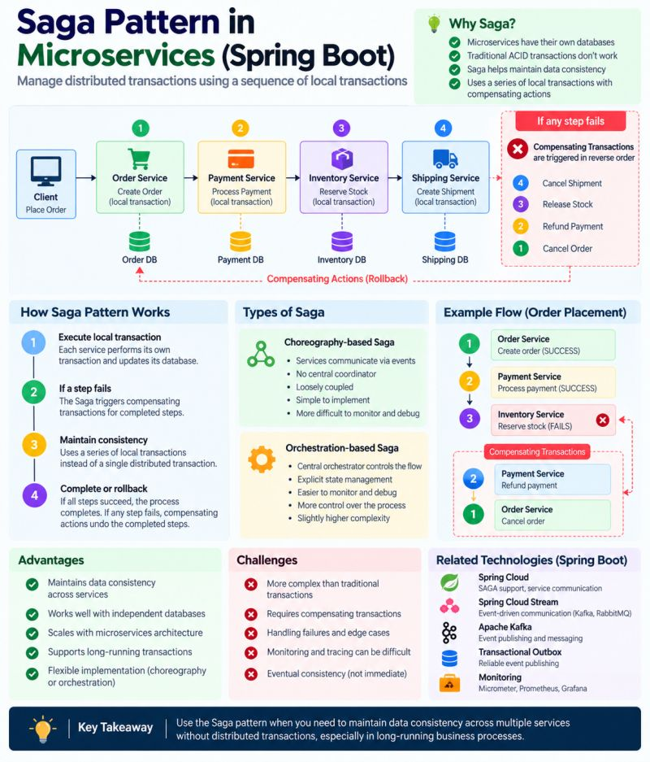

# Saga Pattern in Microservices (Spring Boot)

How do you keep data consistent when one business transaction spans several services, each with its own database?
A **Saga** replaces the single distributed ACID transaction with a **sequence of local transactions**. When a step
fails, the saga runs **compensating transactions** that undo the steps that already succeeded.



This project implements an e-commerce order saga in **both** styles:

| | Choreography | Orchestration |
|---|---|---|
| Who drives the flow | Each service reacts to events | A central `OrderSagaOrchestrator` |
| Coupling | Loose, services only know events | Orchestrator knows every step |
| State | Spread across services (order status) | Explicit `SagaInstance` with step history |
| Monitoring / debugging | Harder | Easier (`GET /api/orchestration/sagas/{id}`) |
| API response | `202 Accepted`, eventually consistent | `201 Created` with final saga state |

## The use case

1. **Order Service** creates the order (PENDING)
2. **Payment Service** charges the customer
3. **Inventory Service** reserves the stock
4. **Shipping Service** creates the shipment

If any step fails, the completed steps are compensated **in reverse order**:

```
Cancel Shipment  <-  Release Stock  <-  Refund Payment  <-  Cancel Order
```

For example, if the inventory reservation fails after the payment succeeded, the payment is refunded and the order is cancelled.

## Architecture

The four services live in one Spring Boot app so the sample is easy to run. They are still kept apart:

- Each service is its own package (`order`, `payment`, `inventory`, `shipping`) and does not touch another service's repositories.
- Each service owns its own database schema (`order_service`, `payment_service`, `inventory_service`, `shipping_service`), which stands in for **database per service**.
- Every service method is a **local transaction** (`@Transactional`). No transaction spans services.
- Choreography events go through Spring's `ApplicationEventPublisher` and are handled `@Async`, the way a Kafka or RabbitMQ consumer would handle them.
- Participants are **idempotent** (charge, reserve and ship once per order), so a redelivered message or a retry is safe.

### Orchestration

```
Client ──POST──▶ OrderSagaOrchestrator
                    ├─ 1. CreateOrderStep      execute: create order     compensate: cancel order
                    ├─ 2. ProcessPaymentStep   execute: charge           compensate: refund
                    ├─ 3. ReserveStockStep     execute: reserve stock    compensate: release stock
                    └─ 4. CreateShipmentStep   execute: create shipment  compensate: cancel shipment
```

Each step's outcome is persisted in `saga_orchestrator.saga_instances` and `saga_step_history`.
A failing compensation is retried up to 3 times. If it still fails, the saga ends as `FAILED`, which means someone has to fix it by hand.

Saga status: `STARTED → COMPLETED` or `STARTED → COMPENSATING → COMPENSATED | FAILED`.

### Choreography

```
Happy path : OrderCreated → PaymentCompleted → StockReserved → ShipmentCreated → order COMPLETED
Payment    : OrderCreated → PaymentFailed → order CANCELLED
Inventory  : … → StockReservationFailed → PaymentRefunded → order CANCELLED
Shipping   : … → ShipmentFailed → StockReleased → PaymentRefunded → order CANCELLED
```

The events are defined in `saga/choreography/event/OrderSagaEvent.java`. Each service handles them in its own `*EventHandler`.

## Simulating failures

| Failing step | How to trigger it | Configured in |
|---|---|---|
| Payment | `amount` greater than `5000.00` | `saga.payment.max-amount` |
| Inventory | `quantity` above the available stock, e.g. `CONSOLE-001` (stock 0) | seeded by `InventoryDataInitializer` |
| Shipping | `shippingCity` is `Atlantis` or `Gotham` | `saga.shipping.unserviceable-cities` |

Seeded products: `LAPTOP-001` (10), `PHONE-001` (20), `MOUSE-001` (50), `CONSOLE-001` (0).

## Running

Requirements: Java 25.

```bash
./mvnw spring-boot:run
```

```bash
# orchestration: inventory fails → payment refunded, order cancelled
curl -s -X POST localhost:8080/api/orchestration/orders \
  -H 'Content-Type: application/json' \
  -d '{"customerId":"CUST-1","productCode":"CONSOLE-001","quantity":1,"amount":499,"shippingCity":"Jakarta"}'

# choreography: accepted as PENDING, then poll the order
curl -s -X POST localhost:8080/api/choreography/orders \
  -H 'Content-Type: application/json' \
  -d '{"customerId":"CUST-2","productCode":"LAPTOP-001","quantity":1,"amount":1500,"shippingCity":"Bandung"}'
```

More requests are in [`saga.http`](saga.http) (IntelliJ HTTP Client).

### Endpoints

| Method | Path | Description |
|---|---|---|
| POST | `/api/orchestration/orders` | Place an order through the orchestrator |
| GET | `/api/orchestration/sagas` | All orchestrated sagas with their step history |
| GET | `/api/orchestration/sagas/{id}` | One saga |
| POST | `/api/choreography/orders` | Place an order through events |
| GET | `/api/orders`, `/api/orders/{id}` | Order Service data |
| GET | `/api/payments` | Payment Service data |
| GET | `/api/inventory/products`, `/api/inventory/reservations` | Inventory Service data |
| GET | `/api/shipments` | Shipping Service data |

The H2 console is at `/h2-console`. The JDBC URL is printed in the startup log.

### Tests

```bash
./mvnw test
```

The tests cover the happy path and failures at payment, inventory and shipping, for both saga styles, plus the HTTP API.

## Trade-offs

- **Pros:** data stays consistent across services without distributed transactions; works with independent databases; scales with a microservices architecture; supports long-running transactions.
- **Cons:** more complex than a local transaction; every step needs a compensating action; failures, retries and edge cases need careful handling; consistency is **eventual**, not immediate; harder to monitor (especially choreography).

In production you would usually add a message broker (Kafka or RabbitMQ through Spring Cloud Stream), the **Transactional Outbox** pattern so events are published reliably, and Micrometer/Prometheus/Grafana for tracing.

> **Key takeaway:** a Saga doesn't give you one ACID transaction across services. It keeps data consistent through local transactions and compensating actions.
